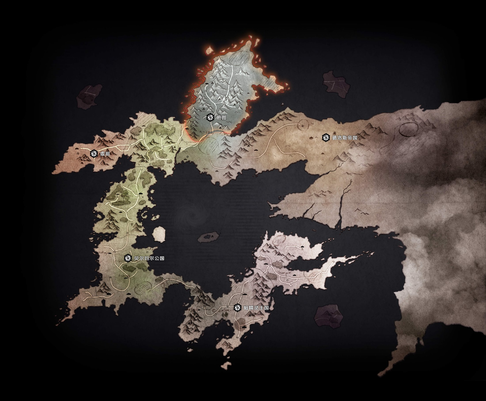
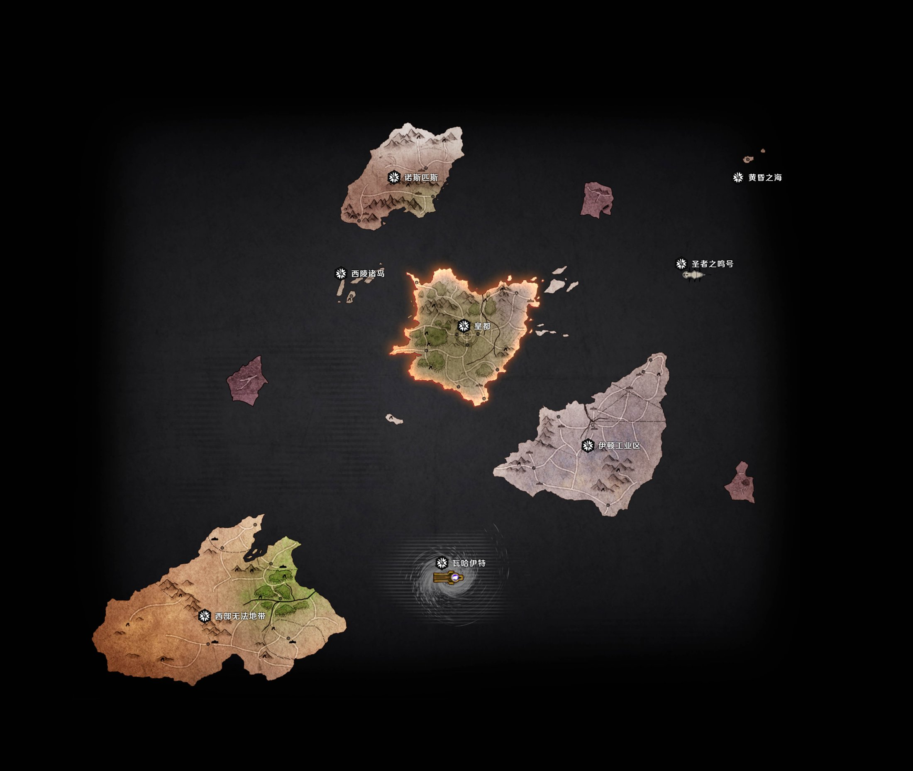
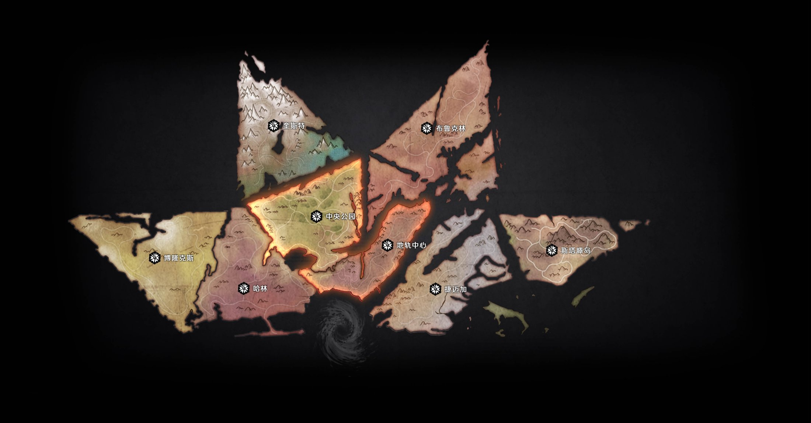
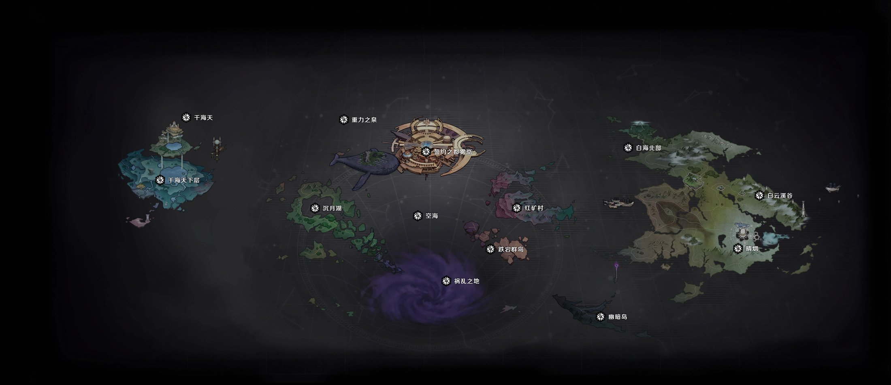

+++
title = 'DNF 世界观与主线故事梳理'
subtitle = "从创世到千海天：一张图看懂阿拉德、魔界、使徒与冒险家"
date = 2026-10-13T02:36:56+08:00
draft = false
toc = true
tags = ['DNF', '游戏剧情', '世界观']
series = []
+++

## 写在前面

DNF（《地下城与勇士》）的世界观，一句话就能概括：

> **神创造了人 → 人又造出了"神" → "神"反噬世界。**
> 而玩家扮演的冒险家，一直以为自己在拯救世界，其实是在**替幕后黑手当刀**。

先打个预防针：这游戏十几年**"吃书"（剧情重写）过好几次**，不同年份的资料对使徒编号、事件顺序的说法会有出入。本文给的是**当前主流 / 最新主线**版本的骨架，细节请以最新主线为准。

---

## 世界观地图（四界总览）

DNF 的世界由**四个世界**构成：**阿拉德大陆**（人类文明的中心）、**天界**（浮空大陆，机械文明）、**魔界**（泰拉崩坏后的残骸，漂泊于异次元）、**神界**（110 级后开辟的新舞台，分白海 / 重泉 / 千海天）。官方「世界百科地图」正是按这四界分区绘制的。

**阿拉德大陆**：贝尔玛尔公国（赫顿玛尔、西海岸）、德洛斯帝国、虚祖、暗精灵王国、班图族的斯顿雪域……冒险故事的主舞台。

**天界**：皇都根特、伊顿工业区、西部无法地带、诺斯匹斯、黄昏之海……曾是巴卡尔的领地，机械文明由此发展，也是安徒恩的旧战场。

**魔界**：中央公园、哈林、地轨中心、寂静城、魔界营地……使徒们的聚集地（卡恩 / 赫尔德 / 普雷 / 卡西利亚斯 / 狄瑞吉 / 罗特斯 / 希洛克 / 安徒恩 / 卢克）。

**神界**：白海、重泉、千海天三大区域；三隐者（玛尔 / 克尔顿 / 埃尔贡）、雾神、千海天战役的舞台。

> 图片来自 DNF 官方「世界百科」地图（[dnf.qq.com/act/a20241120yz/world/map.html](https://dnf.qq.com/act/a20241120yz/world/map.html)），四界各一张；另有 lore 层的"镜像阿拉德"设定。

---

## 一、重要人名 / 地名速查

看剧情前，先把这些名字过一遍，后面读起来会顺很多。

### 人名

| 名字 | 身份 | 一句话介绍 |
| --- | --- | --- |
| **卡洛索** | 伟大的意志 | 创世神级别的存在，破开混沌、创造众神；有光暗两面 |
| **赫尔德** | 第二使徒 | 元素/魔法的鼻祖，"哭泣之眼"，**全篇最大幕后黑手** |
| **卡恩** | 第一使徒 | 宿命者，魔界之王，最强使徒；**至今没被玩家真正打过** |
| **伊西斯·普雷** | 第三使徒 | 天骄，光暗双生，实力≈卡恩 |
| **卡西利亚斯** | 第四使徒 | 征服者，为战而活，召唤师的觉醒技 |
| **希洛克** | 第五使徒 | 潜行者，被转移到悲鸣洞穴，死于卢克西之手 |
| **狄瑞吉** | 第六使徒 | 黑色瘟疫，瘟疫之源；**当前千海天的最终团本 BOSS** |
| **安徒恩** | 第七使徒 | 火焰吞噬者，占据发电站 |
| **罗特斯** | 第八使徒 | 长脚，被转移到天帷巨兽 |
| **卢克** | 第九使徒 | 制造者，建造寂静城，连通魔界与天界 |
| **巴卡尔** | 原第九使徒 | 暴龙王，被除名后逃到天界统治了 500 年 |
| **奥兹玛** | 混沌之神 | 暗黑圣战的反派，被封印到异次元 |
| **米歇尔** | 圣者 | 对抗奥兹玛；千海天线承接使徒之力的关键人物 |
| **赛丽亚** | 知晓一切者 | 太初之光的最大碎片，被玛尔藏于阿拉德 |
| **玛尔** | 神界三隐者 | 大魔法师，冒险家的引路人，布局数百年对抗外神 |
| **克尔顿** | 神界三隐者 | 开创神界"机械时代" |
| **埃尔贡** | 神界三隐者 | 开创"和谐时代"，出身神兽 |
| **波纳尔（纳波尔）** | 雾神前身 | 泰拉人造神之一，败给卡洛索后流落神界 |
| **洛佩斯** | 虚空派首领 | 信奉虚无，目的是让"终末"降临神界 |
| **摩奇亚** | 妖魔王 | 绰号"斗笠哥"，从次元裂缝里听到狄瑞吉的声音，尊其为神 |

### 地名

| 名字 | 一句话介绍 |
| --- | --- |
| **泰拉** | 太古科技巅峰的行星，"十二人造神"诞生地；崩坏后残存主城变成魔界 |
| **魔界** | 泰拉崩坏后漂泊于异次元的残存大陆，异形魔物聚集之地 |
| **阿拉德** | 玩家所在的大陆，人类文明的中心舞台 |
| **天界** | 另一世界的浮空大陆，天族人发展出"机械文明"，曾被巴卡尔统治 |
| **神界** | 最新篇章的舞台，分为**白海、重泉、千海天**三大区域 |
| **悲鸣洞穴** | 希洛克被转移、并被讨伐的地方 |
| **诺伊佩拉 / 诺斯玛尔** | 狄瑞吉被转移、散播瘟疫的地方 |
| **天帷巨兽** | 浮空巨兽，罗特斯被转移到的地点 |
| **寂静城** | 卢克建造，连接魔界与天界的通道 |
| **赫顿玛尔** | 阿拉德的核心城镇，大转移中被炸成废墟 |
| **天空之城** | 阿拉德通往天界的关键通道 |

---

## 二、创世层：伟大意志 · 泰拉 · 十二个"人造神"

- 万物之初，空虚混沌。**伟大的意志**（最主要的具象叫 **卡洛索**）从虚无中浮现，喊出自己的名字，世界便有了光；祂破开混沌，创造了众神。
- 卡洛索有**光暗两面**，暗面被"光之外壳"包裹，封印在 **泰拉** 星深处。
- 太古的 **泰拉** 是科技巅峰的星球。泰拉人发现了宇宙中徘徊的强大能量，用科技给这些力量造出**十二个肉身** —— "十二贝亚娜"，世人把它们当神来崇拜。
- 这十二个"人造神"不感恩，反而挑起世界大战 → **泰拉星崩坏**。只有以"泰拉"为名的主城幸存，被爆炸抛离原空间、漂泊于异次元，一路吞进各种异物 —— 这就是后来的 **魔界**。
- 十二贝亚娜被打散的力量在宇宙各次元游荡、寻找新宿主 → 成了 **使徒** 的源头。

---

## 三、使徒：主线的核心反派群

使徒的定义是：**突破异界限制、进入魔界的顶尖强者**。序列是"到达魔界的先后"，**不是实力排名**（第一使徒卡恩最强）。

| 序列 | 称号 | 名字 | 一句话 |
| --- | --- | --- | --- |
| 第一 | 宿命者 | **卡恩** | 魔界之王，最强；至今没被玩家真正打过 |
| 第二 | 哭泣之眼 | **赫尔德** | 元素鼻祖，幕后黑手，目标是复兴泰拉 |
| 第三 | 天骄 | **伊西斯·普雷** | 光暗双生，实力≈卡恩 |
| 第四 | 征服者 | **卡西利亚斯** | 为战而活，召唤师的觉醒技 |
| 第五 | 潜行者 | **希洛克** | 被转移到悲鸣洞穴，死于卢克西 |
| 第六 | 黑色瘟疫 | **狄瑞吉** | 瘟疫之源；当前千海天的最终团本 BOSS |
| 第七 | 火焰吞噬者 | **安徒恩** | 占据发电站 |
| 第八 | 长脚 | **罗特斯** | 被转移到天帷巨兽 |
| 第九 | 制造者 | **卢克** | 寂静城，连通魔界与天界 |
| 原九 | 暴龙王 | **巴卡尔** | 被除名，逃到天界统治 500 年 |
| — | 混沌之神 | **奥兹玛** | 暗黑圣战，被封印到异次元 |
| — | 圣者 | **米歇尔** | 对抗奥兹玛；千海天线的关键人物 |
| — | 知晓一切者 | **赛丽亚** | 太初之光最大碎片（算不算使徒有争议） |

---

## 四、主线引擎：赫尔德的阴谋

- 第二使徒 **赫尔德** 原本是泰拉人。她依据预言书 **《创新世纪》（泰拉创世纪）**：要复兴泰拉，必须**消灭除她以外的十二位使徒**。
- 要命的一点：**使徒之间无法互相杀死** → 所以她必须借**冒险家（玩家）**的手。
- 她制造"转移"现象，把使徒一个个丢到阿拉德，让它们引发灾难，再"引导"冒险家去讨伐。
- 所以那句台词才这么扎心 —— 罗特斯临死前说：**"冒险家也不过是为了实现预言而听命他人的傀儡。"**

---

## 五、主线时间线（阿拉德篇）

- **阿拉德历 471 年**：玛尔发现无意识的 **太初赛丽亚**（太初之光的最大碎片），设大魔法阵把她藏在阿拉德中心沙漠的绿洲里，之后穿越次元募集盟友。
- **古代 · 暗黑圣战**：奥兹玛觉醒成"伪装者"之源，圣者米歇尔率众对抗，奥兹玛被封印进异次元。
- **977–980 年**：希洛克被转移到悲鸣洞穴，四剑圣讨伐，卢克西战死。
- **狄瑞吉** 被转移到诺伊佩拉，瘟疫蔓延、污染大魔法阵 → 冒险家帮赛丽亚修复，随后登上天空之城。
- 冒险家依次讨伐（大转移前的老版本顺序）：**罗特斯**（天帷巨兽）→ **狄瑞吉**（诺斯玛尔）→ **安徒恩**（发电站）→ **卢克**（寂静城）→ **巴卡尔**（龙之战争 / 天界）→ **希洛克** → **奥兹玛**（圣域之战）→ **米歇尔**……

---

## 六、大转移：剧情分水岭

- 2014 年资料片 **《大转移》**（又译《创新世纪》）。**卡洛索吸收了"最大具象·谜之勇士"后，外溢能量发生大爆炸**，阿拉德大陆被撕裂：赫顿玛尔成废墟、万年雪山崩塌、暗黑城浮出地表、天帷巨兽沉海。
- 1~53 级副本被完全重置，旧剧情"摧毁性"改写 —— 这就是老玩家口中的 **"吃书"**。
- 2018 年《归来》又把时间线拉回大家熟悉的阿拉德。**"大转移前 / 后"是理解 DNF 剧情的分界线。**

---

## 七、神界篇 → 当前千海天（115 级）

- 神界分三区域：**白海、重泉、千海天**。三隐者：**玛尔**（魔法时代）、**克尔顿**（机械时代）、**埃尔贡**（和谐时代）。
- **雾神** 的真身是泰拉人造神 **波纳尔（纳波尔）**，败给卡洛索后流落神界，蒸发身体造出迷雾自保；她无意识回收迷雾，酿成"无云之夜"。
- 冒险家穿过幽暗岛、异面边界，识破 **患妖五怪** 与 **虚空派** 的阴谋。
- **千海天版本（当前剧情）：**
  - 冒险家为见玛尔前往千海天，一路收复被 **虚空派** 占领的失地。
  - 虚空派首领 **洛佩斯** 信奉虚无 / 超越者，目的是让"终末"降临神界；他调虎离山，率主力进攻"贾维的罗盘"，要夺取 **狄瑞吉的使徒之力**。
  - 玛尔揭穿真相：**黑暗之眼根源、四大超越者**，以及他自己几百年来的布局 —— 要在超越者降临的 **虚弱瞬间** 反杀。
  - **米歇尔** 承载两份使徒之力（自己的 + 奥兹玛的使徒气息），是对抗超越者 **莫特尔** 最关键的棋子；他目睹教友惨死与"神的沉默"，决心 **自己成为神**。
  - 反派支线：妖魔王 **摩奇亚**（斗笠哥）从祸乱之地的次元裂缝听到狄瑞吉的声音，尊其为神，用史莱姆 **霍斯迪格** 做容器养着狄瑞吉。
  - **狄瑞吉攻坚战结局**：邪念与狄瑞吉融合，降临最终形态"**流淌邪恶之血者**"，击杀即通关。**狄瑞吉成了这一大篇章的收束使徒。**
- 大方向：**超越者 / 外神才是终极威胁**，连玛尔都要布局几百年；雾神的"死"被解读为冒险家走向 **四觉** 的催化剂。

---

## 八、记住这几条就够用

1. **神造人（卡洛索）→ 人造神（泰拉十二贝亚娜）→ 神反噬 → 世界破碎。**
2. 使徒是"从异界进入魔界的强者"，**序列只是到场先后，不是强弱**。
3. **赫尔德在借刀杀人，玩家就是那把刀。**
4. 使徒一个一个死，代价是 **新的灾难**；阿拉德在"打使徒 — 引灾难"里循环。
5. 当前大棋三条线合流：**赫尔德 / 卡洛索暗面 / 超越者（外神）**。狄瑞吉之后，主线指向 **超越者**。
6. 官方 **爱吃书**，编号和细节以最新主线为准，别拿十年前的老帖当圣经。

---

## 参考

- DNF 官方世界观设定站、官网使徒页 / 狄瑞吉攻坚战页
- 沃特碧 Colg 剧情梳理、腾讯新闻与 17173 的剧情回顾
