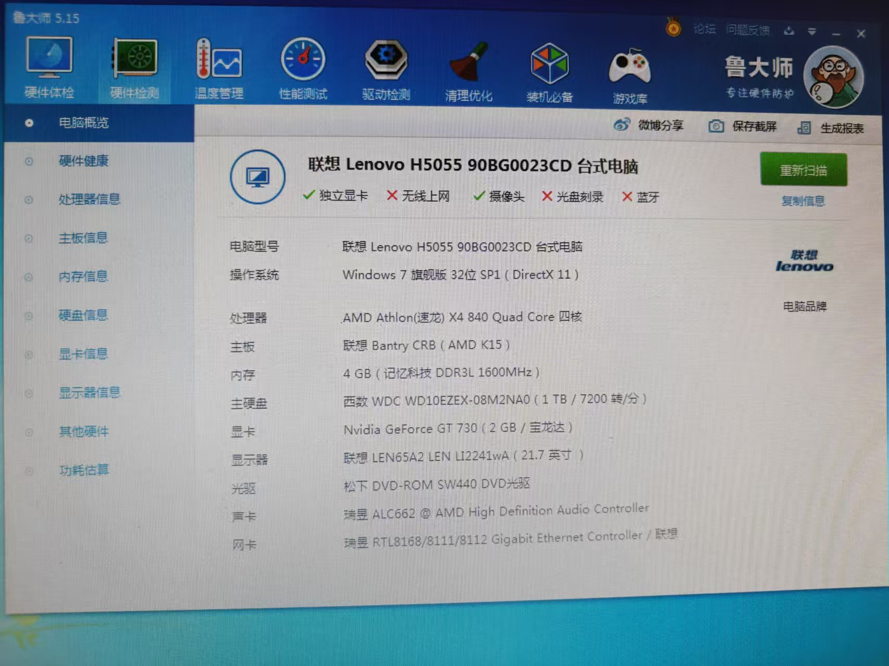
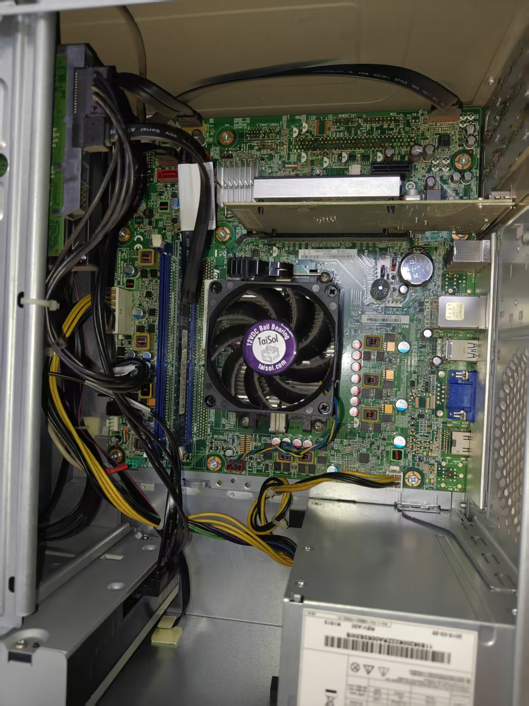
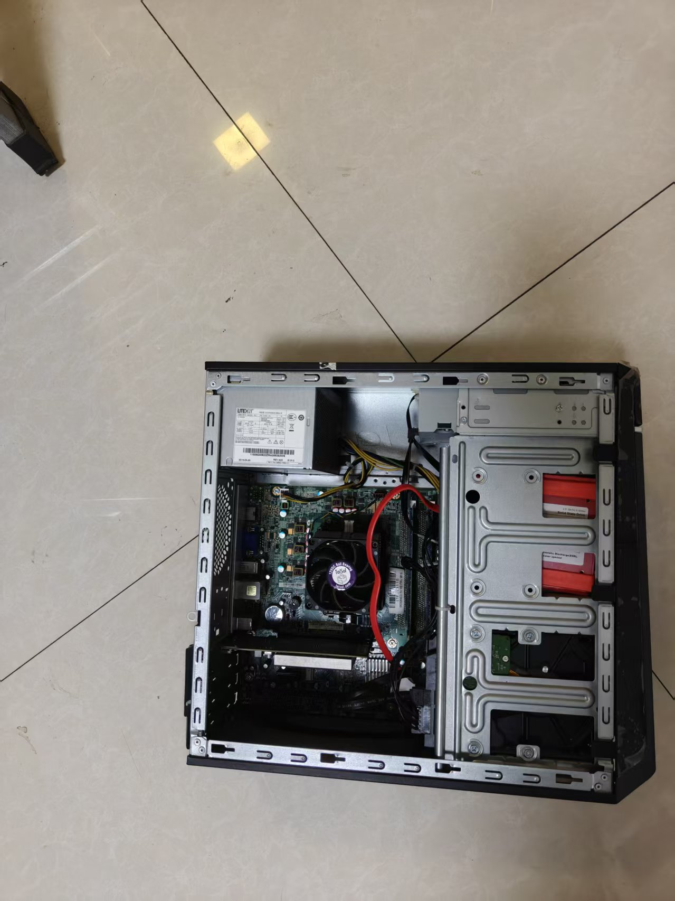
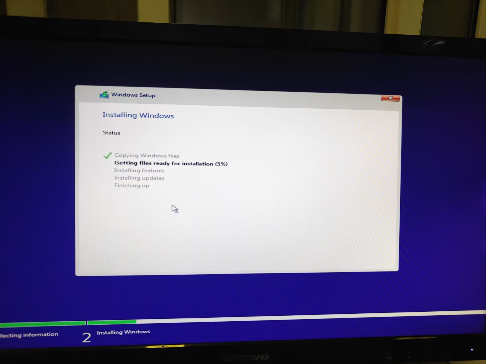
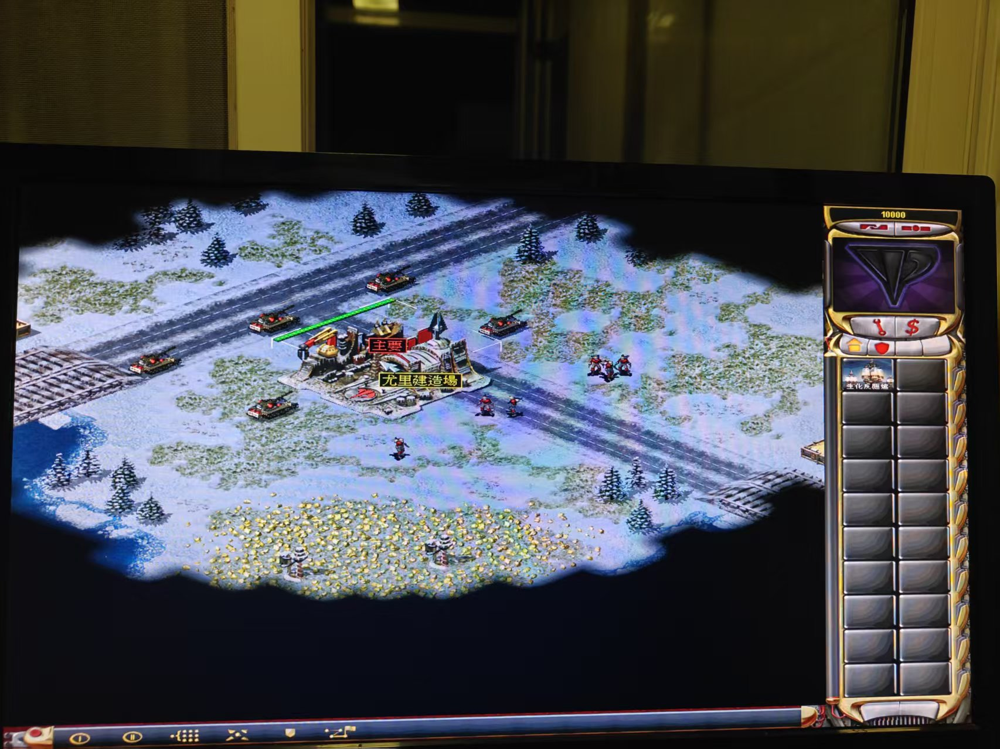
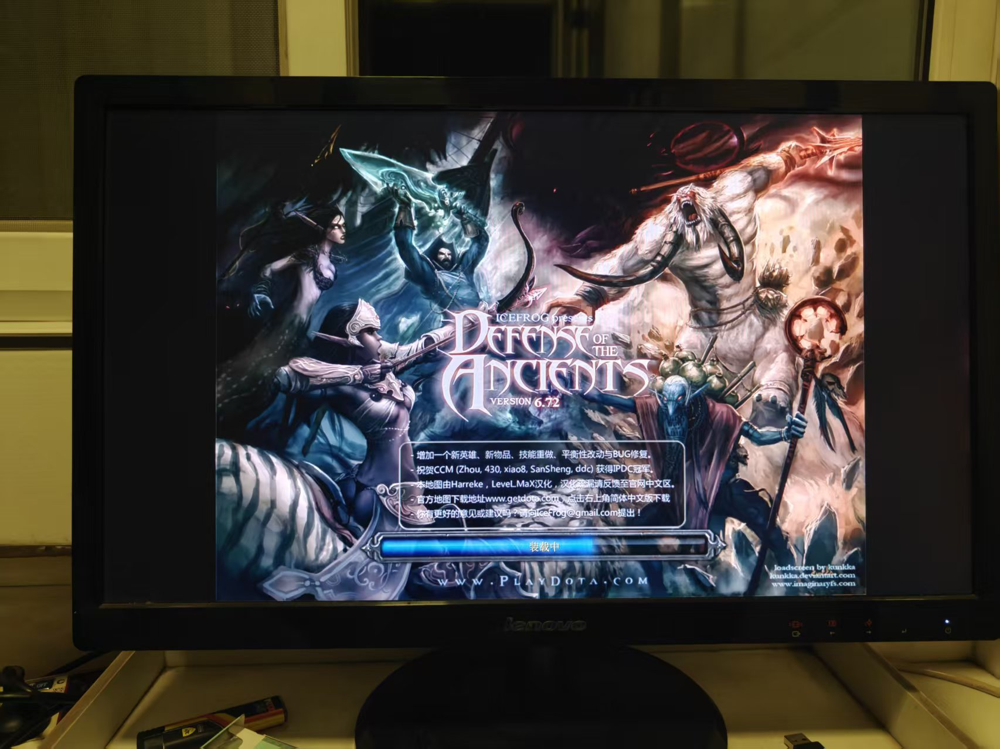

+++
title = '老台式机改造全流程：加内存、换 SSD、装 Win10'
subtitle = ""
date = 2026-10-14T16:30:00+08:00
draft = false
toc = true
series = ['life']
tags = ['硬件', '旧电脑', 'Windows', '复古游戏', '装机']
+++

[toc]

## 起因

家里有一台 2015 年的联想台式机，闲置很久了。想着与其吃灰，不如**送给家人用**——主要需求很简单：

- **玩复古游戏**（第一优先）
- 其次是**浏览网页、看视频**

要求就一条：**花小钱办小事**，别为这台老机器投入太多。

## 原始配置

先用鲁大师扫了一遍：



| 部件 | 型号 | 评价 |
| --- | --- | --- |
| 主机 | 联想 H5055 90BG0023CD | 2015 年入门办公机 |
| CPU | AMD Athlon X4 840 四核 | FM2+ 接口，弱 |
| 主板 | 联想 Bantry CRB (AMD K15) | 品牌机定制板 |
| 内存 | 4 GB 记忆科技 DDR3L 1600 | 单条，2 个插槽 |
| 硬盘 | 西数 WD10EZEX 1TB / 7200 转 | 机械盘 |
| 显卡 | Nvidia GeForce GT 730 (2GB) | 亮机卡 |
| 显示器 | 联想 LI2241wa 21.7" | VGA 接口 |
| 光驱 | 松下 DVD-ROM SW440 | 5.25 寸 |
| 网卡 | 瑞昱 RTL8168 千兆 | **只有有线，无 WiFi / 蓝牙** |
| 系统 | Windows 7 旗舰版 **32 位** SP1 | 早已停止支持 |

## 瓶颈在哪

这台机器"卡"的原因很明确，而且是**三个叠在一起**：

1. **4 GB 内存** —— 现代浏览器开几个标签就爆
2. **机械硬盘** —— 开机慢、点一下等半天
3. **32 位系统** —— 只认 3.5 GB 内存，加了内存也白加

CPU 也弱，但换 CPU 的收益和风险都不划算，后面单独说。

## 升级方案

最终只做两件事 + 换系统：

| 项目 | 原状 | 升级到 | 花费 |
| --- | --- | --- | --- |
| 内存 | 4 GB 单条 | **8 GB 双通道**（补一条 4G DDR3L 1600）| 20–40 元（二手）|
| 系统盘 | 1TB 机械盘 | **240 GB SATA SSD** | 150–250 元 |
| 系统 | Win7 32 位 | **Win10 IoT 企业版 LTSC 2021 x64** | 0 元 |
| 网络 | 只有有线 | **USB 无线网卡**（可选）| 30–50 元 |

**合计 ≈ 200–350 元。** 1TB 机械盘留着当数据盘，等于又省了一个移动硬盘。

### 内存：为什么不买 8G 单条

- 现在只有 1 条 4G，**再补 1 条 4G** 就是 8G **双通道**，最便宜
- 如果换成"4G + 8G = 12G"，**两条容量不一致会失去双通道**，反而可能更慢
- 对"复古游戏 + 上网"来说，**8G 是甜点，12G/16G 用不上**

### DDR3 还是 DDR3L？

这块板子两个都支持，但**买 DDR3L**：

- DDR3L 是**双电压**（1.35V/1.5V），插 1.35V 和 1.5V 的槽都能用，**万能**
- 反向不行：纯 1.5V 的 DDR3 插到只认 1.35V 的板子上会点不亮
- 原装那条就是 DDR3L，买一样的直接组双通道

## 系统怎么选：Win7 还是 Win10

一开始考虑过继续用 Win7 64 位，最后还是选了 **Win10 IoT 企业版 LTSC 2021**，理由很硬：

| | Win7 | **Win10 IoT LTSC 2021** |
| --- | --- | --- |
| 浏览器 | **Chrome/Firefox/Edge 全部停止支持** ❌ | 正常 ✅ |
| 安全更新 | 2020 年已停 | **到 2032 年** ✅ |
| 预装推广 | — | **无** ✅ |
| 强制大版本升级 | — | **无**，只打安全补丁 ✅ |

> 注意区分：**IoT** Enterprise LTSC 2021 支持到 **2032-01-13**；普通 Enterprise LTSC 2021 只到 2027。

**Win7 唯一的优势场景是"纯离线玩老游戏"**，但既然还要上网，这条路直接不成立。

## 动手：装内存和 SSD

机箱内部原样——中间是 CPU 风扇，左边一竖排是硬盘/光驱笼，右下角是电源：



### 内存

1. 关机、拔电源线、按住电源键 5 秒放电
2. 开侧板，找到空的内存槽（旁边就是那条 4G）
3. 掰开卡扣 → 金手指对准防呆缺口 → 垂直按下，听到"咔"即可
4. 开机进 BIOS 确认是 8 GB

### SSD

- 接口：**2.5 寸 SATA3**（这块老主板**没有 M.2**）
- 装在原来的 3.5 寸硬盘位：用 **2.5 转 3.5 硬盘支架**（几块钱），或直接拧在笼子的 2.5 孔位上
- **供电**：电源引出的 SATA 供电头不够，最后**借用了光驱的 SATA 电源线**（光驱拔了不用）
- 主板上一共 **4 个 SATA 口**（BIOS 里 SATA 1~4），机械盘接 SATA 1、SSD 接 SATA 2

装好之后的样子，能看到新加的那根红色 SATA 数据线：



## 做启动盘（Rufus）

工具：**Rufus 4.15**（免安装），镜像：`en-us_windows_10_iot_enterprise_ltsc_2021_x64.iso`。

**关键设置（老 BIOS 机器）：**

| 项 | 值 |
| --- | --- |
| 分区类型 | **MBR** |
| 目标系统 | **BIOS（或 UEFI-CSM）** |
| 文件系统 | 默认（NTFS）|
| 镜像模式 | ISO 镜像模式（推荐）|

## BIOS 踩坑：F12 里根本看不到 U 盘

这是整件事里**最坑的一步**。

开机猛按 F12，启动菜单里只有：

```
SATA 2: SSD 256GB
SATA 1: WDC WD10EZEX-08M2NA0
Network 1: Realtek PXE B02 D00
Enter Setup
```

**U 盘完全不见了。** 排查顺序：

1. **换 USB 口** —— 插主板**后置黑色 USB 2.0**，别用 hub、别用前面板（没用）
2. **关 Quick Boot** —— 没用（而且 U 盘其实一直被识别到）
3. **真正的元凶**：进 BIOS → `Startup` → `Primary Boot Sequence`，发现 U 盘被扔进了 **"Excluded from boot order"**：

```
Excluded from boot order:
   ▼ USB HDD:
      USB HDD 1: VendorCoProductCode 2.00   ← 就是它
   USB CDROM:
```

**解决**：光标移到它上面 → 按 **`X`**（联想 BIOS 的包含/排除键）把它移回启动顺序 → 再用 `+` 排到第一位 → `F10` 保存。

顺带记下这台机器的 BIOS 设置（老机器要这样）：

| 设置 | 值 |
| --- | --- |
| CSM | Enabled |
| Boot Mode | **Legacy Only** |
| Quick Boot | Enabled（跟这个问题无关，不用改）|

> 教训：**F12 看不到启动设备时，去 `Primary Boot Sequence` 的"已排除"列表里找。**

## 装系统

1. F12 → 选 `Legacy: <U盘>` → 回车
2. **看到 `Press any key to boot from USB...` 立刻狂按空格** ⚠️
   - 只停 2~3 秒，错过就自动跳到内置硬盘，又进了旧系统
3. 进入安装程序 → **现在安装** → 许可 → 类型选 **自定义**
4. **选盘**：认容量，选那块 **~238 GB 的 SSD**，把卖家预装系统留下的分区**全删掉** → 装到未分配空间
   - ⚠️ **千万别选 ~931 GB 的机械盘**（上面有数据和 Win7）
5. 版本选 **Windows 10 IoT Enterprise LTSC 2021**
6. 到账户界面：**拔掉网线**（这台没 WiFi）→ 选"我没有互联网连接" → **创建本地账户**
   - 家人不需要 Microsoft 账号，本地账户完全够用



## 装完的收尾

### 中文乱码

因为是 en-us 版本，装了中文语言包后界面虽然变中文，但**部分程序乱码**。原因是**"非 Unicode 程序的语言"还是英文**：

> 控制面板 → 区域 → **管理** → **更改系统区域设置** → 选 **中文(简体，中国)** → 重启

**注意**：那个 `Beta: 使用 Unicode UTF-8 提供全球语言支持` **不要勾**，勾了反而会让一些中文老软件乱码。

### 驱动

设备管理器里剩两个黄色感叹号：

| 设备 | 是什么 | 影响 |
| --- | --- | --- |
| `USB2.0-CRW` | **读卡器**缺驱动 | 不用读卡器就没影响 |
| `PCI设备` | 某个 PCI 设备缺驱动 | 同上 |

解决：**设置 → 更新 → 高级选项 → 可选更新 → 驱动程序更新**，全勾上装完重启，基本就好了。

## CPU 要不要换？

算过一遍，**不换**。

这块板是 **FM2+ 接口**，理论上能上到：

| 型号 | 频率 | 功耗 |
| --- | --- | --- |
| Athlon X4 860K / 870K | 3.7–3.9G | 95W |
| **Athlon X4 880K** | 4.0G | 95W |
| A10-7850K / 7890K | 3.7–4.1G | 95W |
| A8-7600 / A10-7800 | 3.1–3.9G | **65W** |

**但不值得，三个原因：**

1. **联想 BIOS 白名单** —— OEM 板只认原厂配过的型号，换别的可能**直接点不亮**
2. **供电/电源** —— 原来是 65W 的 X4 840，上 95W 的 880K，OEM 小电源和供电大概率撑不住
3. **收益太小** —— 同平台同架构，最多快 **10~20%**；模拟器吃单核性能，该跑不动还是跑不动

**结论：这台机器瓶颈是整个平台，不是换个 CPU 能救的。** 要折腾也只建议换 65W 且原厂配过的型号（A8-7600 等），小升级，别期待质变。

## 复古游戏怎么装

这台机器（X4 840 + GT 730）的定位很清楚：

| 能爽玩 ✅ | 吃力/别想 ⚠️ |
| --- | --- |
| FC / SFC / MD / GB / GBA | PS2 |
| PS1 / N64 / 街机（MAME）| GameCube / Wii |
| PSP（大部分）| Dreamcast（部分）|

先看两张实际跑起来的效果——





装一套就够用：

- **RetroArch** —— 全能前端，一个软件管所有主机模拟器
- **MAME** —— 街机
- **DOSBox-X** —— DOS 老游戏
- **ScummVM** —— 冒险游戏
- **老 Windows 游戏兜底**：`cnc-ddraw`（DirectDraw 老游戏）、`dgVoodoo2`（老 DirectX 转现代显卡）、`DxWnd`（窗口化+兼容修正）
- 顽固的可以上 **VirtualBox + WinXP/98 虚拟机**

## 花费与效果

| 项目 | 花费 |
| --- | --- |
| DDR3L 1600 4GB（二手）| 20–40 元 |
| 240GB SATA SSD | 150–250 元 |
| USB 无线网卡 | 30–50 元 |
| **合计** | **≈ 200–340 元** |

效果：开机从 40–60 秒降到 10 秒左右，网页和模拟器都流畅了。**对比买新机 2000–3000 元，这 200 块花得值。**

## 踩坑速查

| 问题 | 原因 | 解决 |
| --- | --- | --- |
| F12 看不到 U 盘 | 被列进"Excluded from boot order" | BIOS → Primary Boot Sequence → 按 `X` 加回 |
| 选了 U 盘却进了旧系统 | 错过 `Press any key` 提示 | 选完立刻狂按空格 |
| 装完中文乱码 | 系统区域设置还是英文 | 区域 → 管理 → 更改系统区域设置 → 中文(简体，中国) |
| 32 位系统用不满 8G 内存 | 32 位上限 3.5G | 装 **64 位**系统 |
| SATA 电源头不够 | OEM 电源引线少 | 借光驱的 SATA 电源，或买 `SATA 电源一分二` / `大4pin 转 SATA` |
| 驱动黄色感叹号 | 缺读卡器/PCI 驱动 | Windows Update 可选驱动，或按硬件 ID 找 |

## 总结

**老机器焕新的核心是"找到真瓶颈，只补那两块板"。** 这台机器的问题就是"4G 内存 + 机械盘 + 32 位系统"，补一条内存、换一块 SSD、装个轻量系统，就够家人上网看视频 + 玩复古游戏了。

三条经验：

1. **别过度投入** —— 老平台的瓶颈是整体设计，换 CPU/显卡的收益远小于换内存和硬盘
2. **系统要选有支持的** —— 2026 年了，Win7 连现代浏览器都装不了，直接排除
3. **启动盘用 Rufus，MBR + BIOS** —— 老机器记得到 BIOS 的"已排除"列表里把 U 盘捞出来
