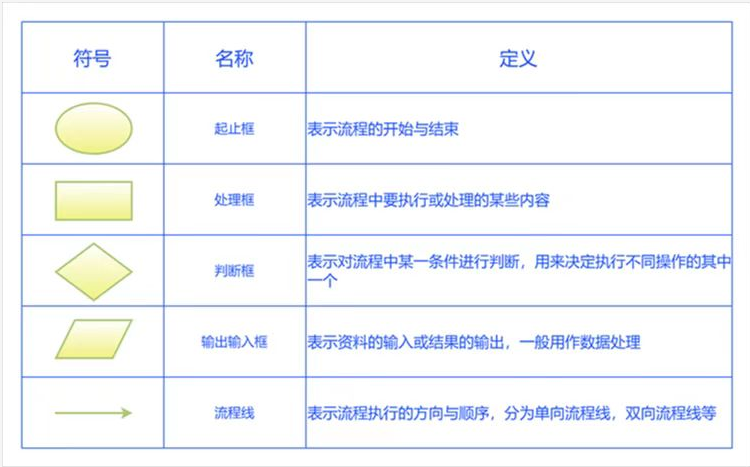

+++
title = 'Flow Chart'
subtitle = ""
date = 2024-05-26T00:21:47+08:00
draft = false
toc = true
tags = ['tools']
featureimage = "featured.webp"
aliases = ["/posts/tools/flow-chart/flow-chart/"]
+++

