+++
title = '指环王三的两场戏：一场教你怎么冲锋，一场教你怎么面对死亡'
subtitle = "希优顿先把死讲透，甘道夫把死讲成一片海岸，迪耐尔把死当成了唯一结局"
date = 2026-11-19T22:17:00+08:00
draft = false
toc = true
series = ['videos']
tags = ["指环王", "勇敢"]
featureimage = "featured.webp"
+++

两段台词，一个在战场上，一个在城楼上。希优顿喊的是「冲向毁灭，冲向世界末日」；甘道夫说的却是白沙湾、辽阔的绿荫，末了还加一句「死亡也没那么可怕」。一个把最坏的结果甩到全军脸上，一个把最坏的结果描述成一幅风景。**它们做的是同一件事：先把死看清楚。**

## 第一场战役：帕兰诺平原

### 00 · 对面来了什么

投石与攻城塔先到，兽人海随后，白城被围成好几层。几乎同时，另一支援军正从山里往外走——不请自来，也不属于活人。


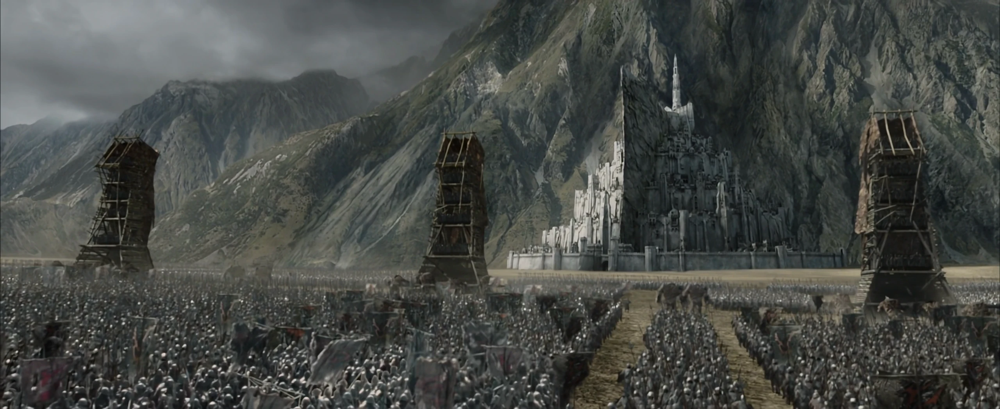
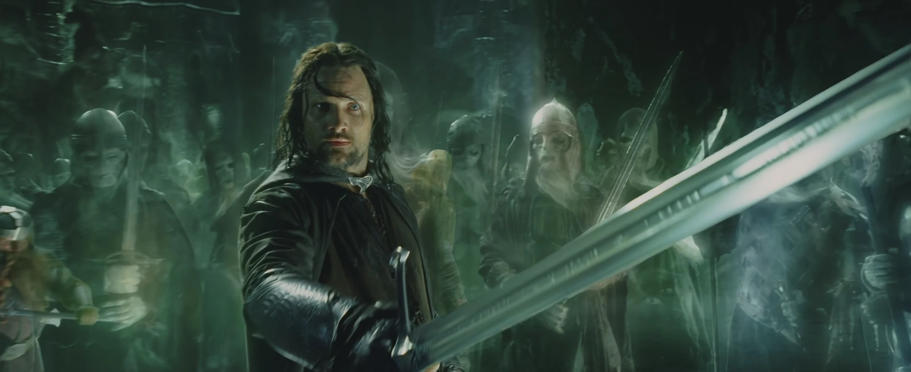

### 11 · 城里的两种人

城被围的第三天，白城里有两个人在处理同一件事——接下来可能会死——走的路完全相反。

一个是甘道夫。皮平怕，但他怕的不是疼，是不知道后来会怎样。甘道夫没说“你不会死”，他说的是死后的样子：

> 当阴霾渐渐褪去
> The grey rain curtain of this world rolls back...
>
> 眼前一片银白
> and all turns to silver glass.
>
> 然后你会看见
> And then you see it.
>
> 白沙湾
> White shores...
>
> 死后的世界
> and beyond.
>
> 在黎明的晨曦中
> A far green country...
>
> 一片辽阔的绿荫
> under a swift sunrise.
>
> 死亡也没那么可怕
> that isn't so bad.
>
> 一点也不可怕
> No, it isn't.

重点在**具体**。恐惧最吓人的时候是模糊的——一旦有了画面，它就从“无尽的黑暗”变成“一片海岸”。皮平听完说“死亡也没那么可怕”，甘道夫答“一点也不可怕”，一问一答，事情落地了。这一步不是安慰，是认知。

另一个是宰相迪耐尔。他握着真知晶球，能看到远方——情报不比任何人少。问题是他看到的全是索伦选择让他看的版本，于是他只得出一个结论：赢不了。

他不逃，也不让别人逃。最后要把重伤的儿子和自己一起烧掉：

> 将我们点燃
> Set a fire in our flesh.





丧胆不是没有勇气，是**提前把结局判死**，然后拒绝承认还有第二种可能。迪耐尔从来不缺面对最坏结果的胆量——他每天都在看它；他缺的是相信除它之外还有别的东西。

### 22 · 六千支矛

说他“慷慨激昂”其实漏了重点。这段演讲的顺序值得逐句拆：

> 前进，不要惧怕黑暗
> Forth, and fear no darkness!
>
> 斩断长矛
> Spears shall be shaken...
>
> 敲碎盾牌
> Shields shall be splintered...
>
> 今日一战，血染黄沙
> a sword-day, a red day...
>
> 红日东升
> and the sun rises!
>
> 向前
> Ride now!
>
> 向前
> Ride now!
>
> 向前，向着毁灭
> Ride! Ride for ruin...
>
> 向着世界末日
> and the world's ending!

先承认矛会被斩断，再承认盾会被敲碎，然后说今天是血染黄沙的一天——**前三句全是坏消息**。太阳照常升起只是补一句客观事实，最后才喊 Ride。


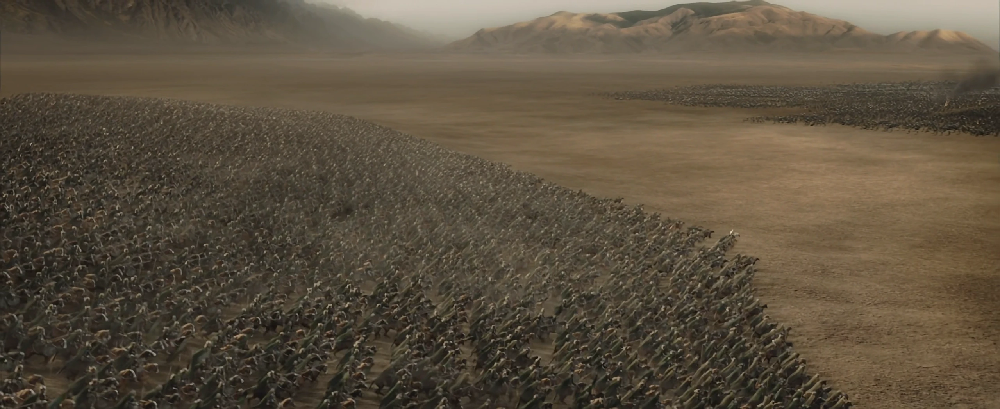
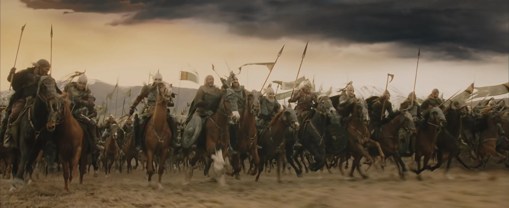
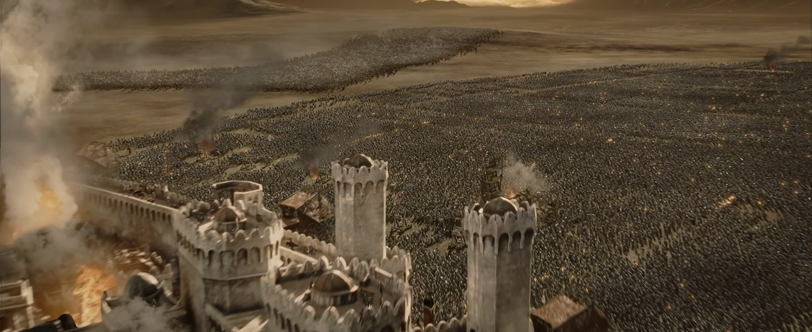
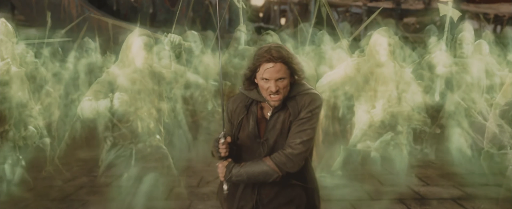


他手里是六千支矛，不到期望的一半，对面是铺满平原的兽人大军。这件事他早就当面说过，没有藏着。所以这不是打气，是**把恐惧的账结清**：能想到的坏结果全摆出来，摆完了，剩下的动作才有意义。全军最后回应的那一声「Death!」不是不怕死，是接过这个结果。

冲锋没有让他活下来，但把战局拖到了阿拉贡和亡灵军团抵达。**靠的不是勇气本身，是这六千人在知道结局的前提下还肯动。**

### 33 · 对面的规模

账算得没有错。猛犸碾过骑兵，兽人海一层压一层，投石把塔楼砸塌。希优顿本人没能活着离开帕兰诺平原。



但这两张图之间隔着一件事：**这场仗最后是赢了。**压到城下的兽人海和碾过来的猛犸，被洛汗骑兵顶住正面，又从背后被阿拉贡带来的亡灵军团扫散。规模能决定开局，决定不了结局。



## 第二场战役：黑门之前

帕兰诺平原之后是黑门。这一场没有六千支矛，只有一支明知会被围死的队伍，站到索伦的家门口去当诱饵——为了让一个人有机会把戒指送进火山。


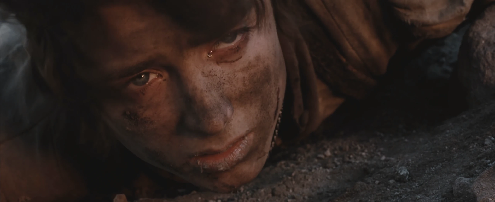
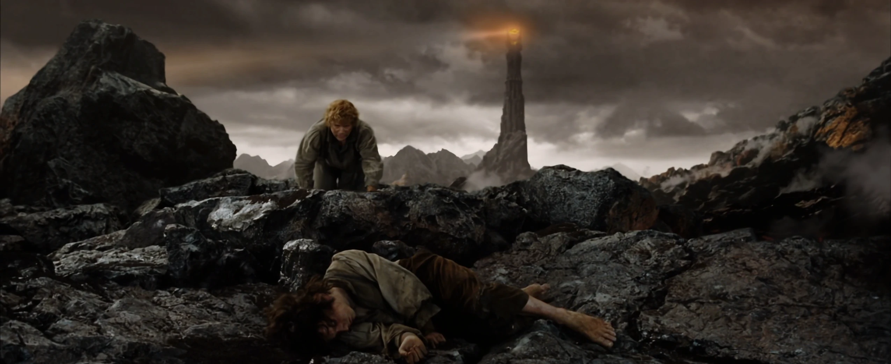


弗罗多和山姆把戒指一路背到火山口。最后一段路弗罗多走不动了，是山姆背上去的——**一个人扛不住的时候，另一个人替他扛了一段**。


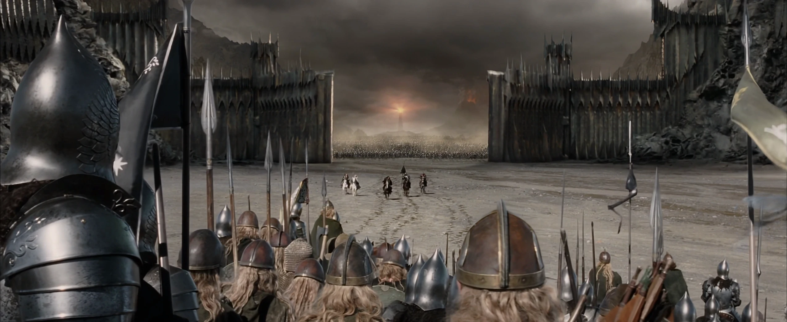
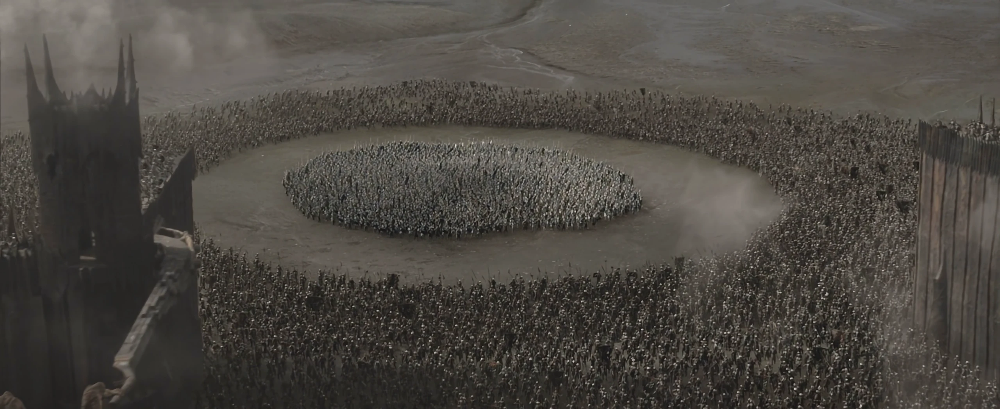
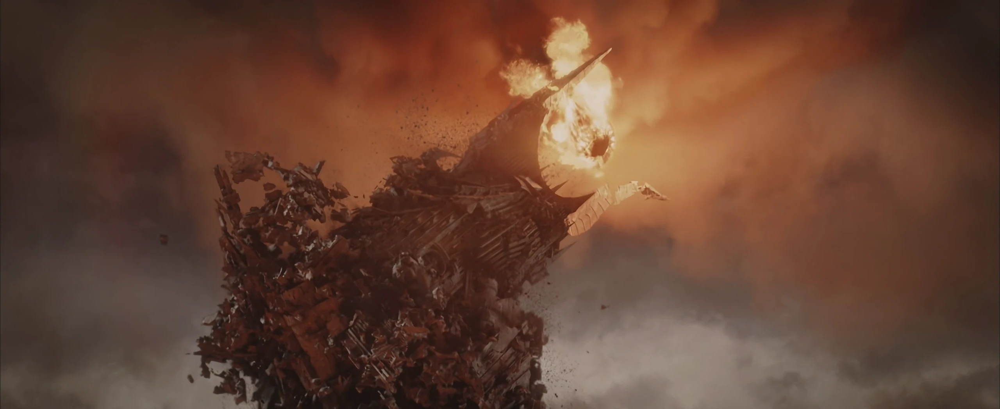
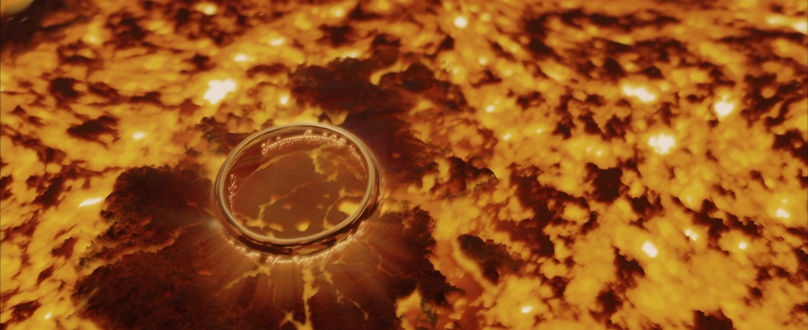


黑门那支队伍活下来的人不多，但**这一场的目的从来不是赢，是让别人有机会赢**。

## 三种人，分界线在哪

- 希优顿：把最坏的结果**公开**，让全军一起接受，然后冲
- 甘道夫：把最坏的结果**描述清楚**，让一个人能接受，然后站着
- 迪耐尔：把最坏的结果当成**唯一定局**，于是既不冲，也不让别人站着

前两个人的共同点不是勇敢，是他们算完最坏的账之后，**还给别的可能性留了位置**。迪耐尔把最坏那一条当成了全部，剩下的路在他眼里就不存在了。

**勇敢的反面不是死亡，是认定只有一种结局。**

## 结局

多出来的那些可能性，是六千支矛、一座城楼、一支诱饵部队换回来的。最后落在两个画面上。


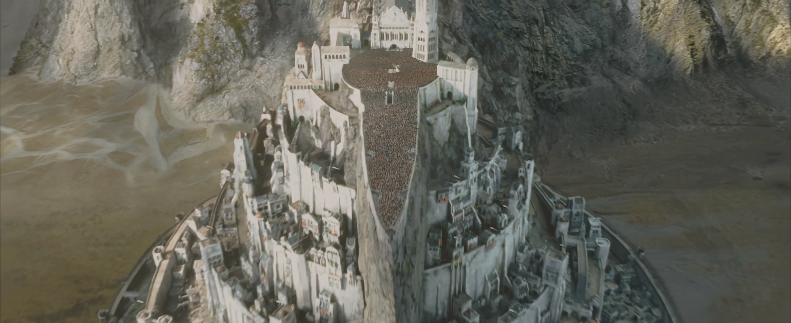
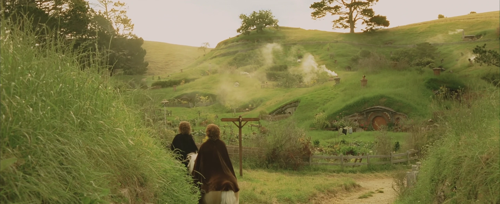


冲锋的意义不在冲锋本身，在于有东西值得回去。

## 落到现实

现实中很少有“冲锋”这种仪式性的时刻。多数时候，“难而正确的事”长得像这样：一个要下的决定、一段看不到头的坚持、一件可能白做的事。没有战鼓，也没有人在旁边喊 Ride。

能用的还是那两步：

1. **把最坏的结果算清**：做不成会怎样，代价承不承受得起
2. **把模糊的恐惧具体化**：到底在怕什么，那件事有没有形状

两步走完，通常会发现问题没那么大——真正消耗人的从来不是最坏的结果，是不知道那是什么。

## 最后

希优顿那句「前进，不要惧怕黑暗」，前半句是动作，后半句是条件。**不惧怕黑暗的前提，是知道黑暗里有什么。**

剩下的，就是信念、执着，做难而正确的事。
